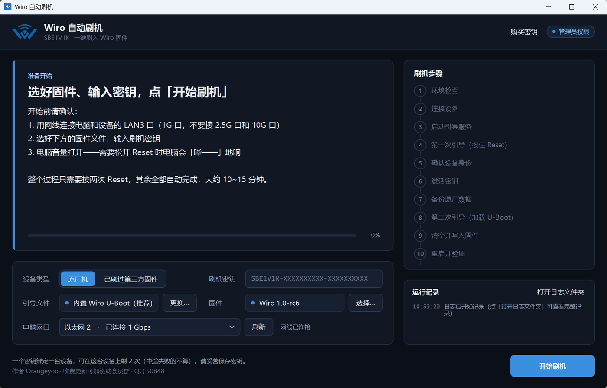
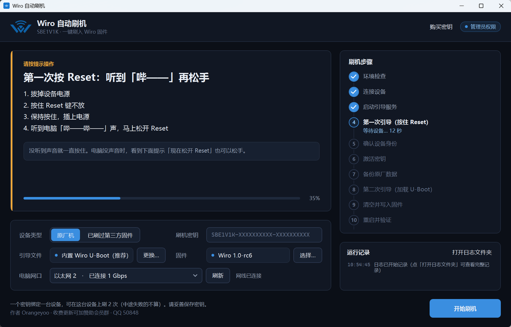
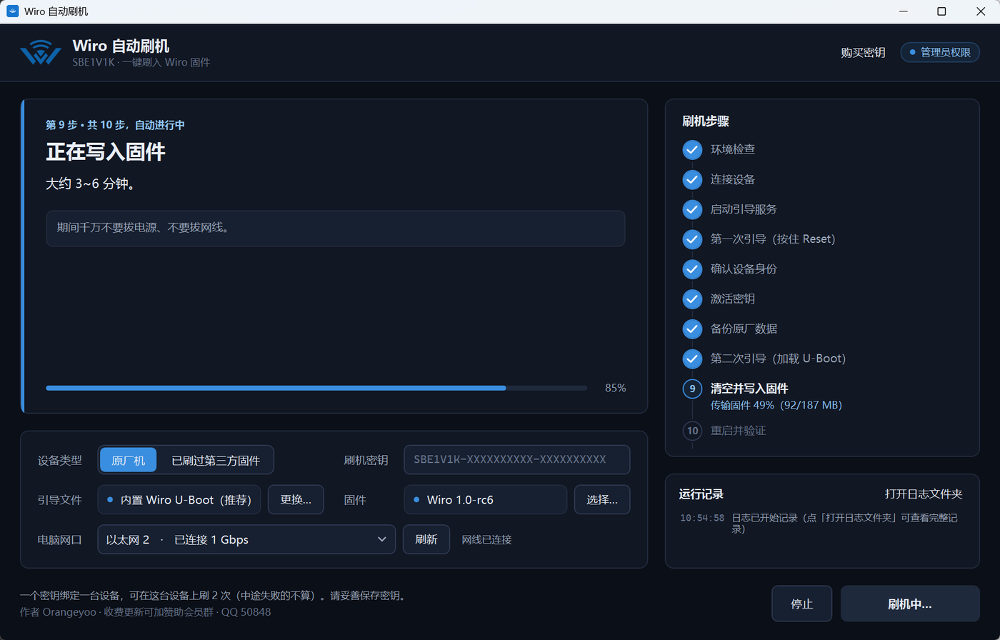
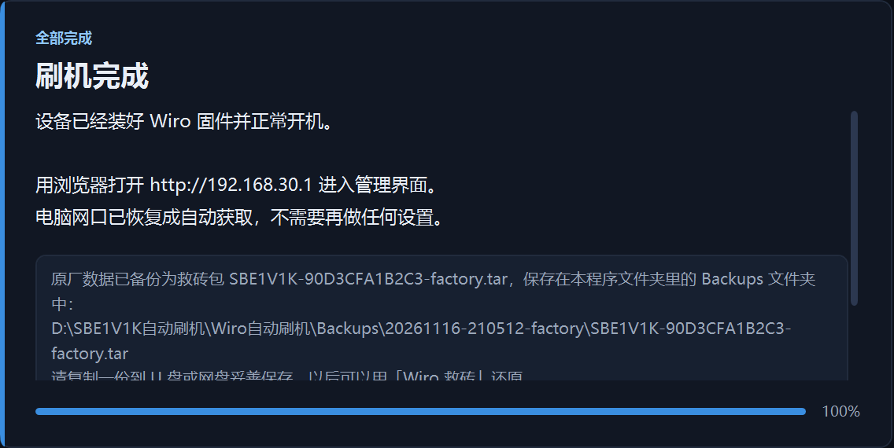
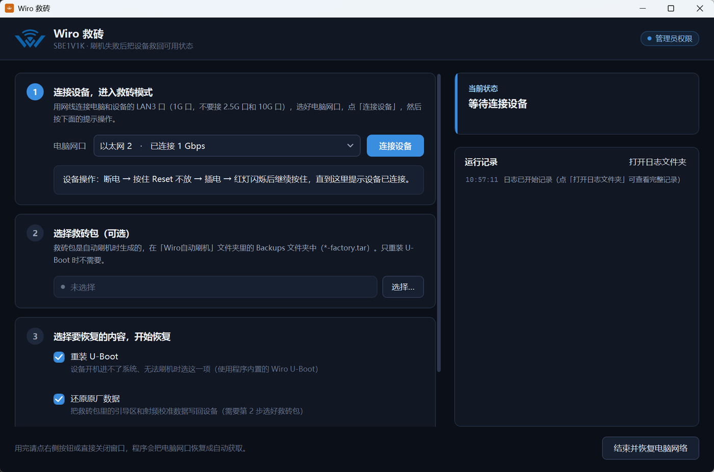

  

<h1 align="center">SBE1V1K Flashing · OpenWrt / iStoreOS in one click, no disassembly, no TTL</h1>

  <b>Spectrum SBE1V1K (Askey RTQ7300T) Wi-Fi 7 router · Qualcomm IPQ9574 + 3× QCN9224</b> 
  No case opening, no cables, no commands to type — press Reset twice and the Wiro iStoreOS firmware is flashed in 10–15 minutes

  
  

  
  
  
  
  
  
  
  
  
  

  <a href="#one-click-flashing">One-click flashing</a> ·
  <a href="#three-steps">Three steps</a> ·
  <a href="#firmware-highlights">Highlights</a> ·
  <a href="#measured-results">Measured results</a> ·
  <a href="#faq">FAQ</a> ·
  <a href="../../releases/latest">Download</a> ·
  <a href="README.md">简体中文</a>

---

## One-click flashing

The stock SBE1V1K system is locked down tight. Flashing OpenWrt the traditional way means opening the case, soldering or clipping onto a TTL serial port, setting up TFTP and typing U-Boot commands line by line — one mistake can brick the device.

**Wiro AutoFlash** automates all of it:

| | Traditional TTL flashing | **Wiro one-click flashing** |
|---|---|---|
| Disassembly | Open the case, find the serial port | **Not needed** |
| Equipment | USB-TTL adapter, dupont wires, TFTP software | **One network cable** |
| Procedure | Change IPs, type a dozen commands | **Press Reset twice**, release on the beep |
| Time | 1–2 hours | **10–15 minutes** |
| Factory backup | Manual download, ~1.5 hours | **Automatic backup** of the boot area and RF calibration into a rescue package |
| If it goes wrong | Open the case again, attach TTL | **Wiro Rescue** restores in one click |
| Support | On your own | **Member group** Q&A + future firmware updates |

| Reset presses are guided by beeps | Firmware is written automatically |
|---|---|
|  |  |

### Purchase & membership

- **[Buy a flashing key here](https://wzyp.cn/shop/155QK568)**: one key is bound to one device and covers **2 flashes** on it; failed attempts don't count
- Buyers join the **member group 1061612207**: flashing help and early access to future firmware updates
- Why it costs money: it saves you the disassembly, wiring and debugging; the income keeps this firmware improving — porting and debugging Wi-Fi 7 and the NSS hardware offload burned a lot of AI compute credits

## Three steps

1. **Download**: get the `Wiro-AutoFlash` archive from [Releases](../../releases/latest) and extract it fully (the firmware is included)
2. **Connect**: plug the network cable into the **LAN3 port (1 GbE)**, run the program as administrator, enter your key and click "Start"
3. **Press Reset twice as prompted**: everything else is automatic; when it finishes, open `192.168.30.1` in a browser

Illustrated guide: [SBE1V1K Flashing & Rescue Guide (PDF, Chinese)](docs/SBE1V1K-Flashing-Guide-ZH.pdf)

**The rescue package is saved automatically**: when flashing a stock unit, the factory boot area and RF calibration data are backed up to `Wiro AutoFlash\Backups\`. RF calibration is unique to each unit — copy it to a USB stick or cloud storage.

## Firmware highlights

Wiro firmware moves the SBE1V1K from the stock Linux 5.4 + closed drivers to a full **Qualcomm QSDK 14 port (OpenWrt 24.10 / Linux 6.6 / open-source ath12k)**:

| | |
|---|---|
| **Wi-Fi 7 tri-band** | 2.4 GHz EHT40 · 5 GHz EHT160 · 6 GHz **EHT320**; OWE transition so older clients can still connect |
| **Two-unit mesh** | dedicated 6 GHz 320 MHz backhaul, measured 1.17 Gbps |
| **10 GbE port** | measured **7.72 Gbps**; works with switches / NAS / PCs |
| **NSS hardware offload** | ECM + PPE forwarding, Wi-Fi PPE-DS direct path |
| **More resilient radios** | WBE.1.4 WLAN firmware: a crashed radio recovers in place in ~8 s — no reboot, other bands unaffected |
| **iStoreOS** | iStore app store (offline feed, works out of the box), QuickStart wizard |
| **Bundled plugins** | OpenClash, PassWall (Xray / sing-box), Docker, AdBlock, WireGuard, OpenVPN, file sharing |
| **PPPoE tuning** | stale sessions cleaned at boot, dial-up records survive upgrades |
| **Full hardware support** | temperature-controlled fan, CPU DVFS, status LEDs, factory MAC on every port |

## Measured results

Measured 2026-11-17 on two SBE1V1K units in daily use (main router + mesh node) with other household clients attached. iperf3 3.22; PC NICs: HPE 10G + Qualcomm FastConnect 7800 Wi-Fi 7; Wi-Fi tests bind to the WLAN address.

| Test | Result |
|---|---|
| 10G port, PC → router | **7.72 Gbps** (4 streams) · 4.70 Gbps (1 stream) |
| 10G port, router → PC | **6.96 Gbps** (8 streams) · 4.15 Gbps (4 streams) |
| 10G port to a switch | works; the main router's 10G port serves a switch with 3 devices in daily use |
| 6 GHz mesh backhaul (320 MHz 802.11s) | main → node **1.17 Gbps** · node → main 0.96 Gbps (8 streams) |
| 5 GHz 160 MHz (PC on the node, 2882 Mbps link, -47 dBm) | up **0.82 Gbps** · down 0.61 Gbps, node also carrying the mesh and other clients |
| Radio crash recovery | injected 6 GHz firmware assert: that radio recovers in **~8 s**, mesh rejoins in 35 s, no reboot |
| Uptime | both units 21 h+, PPPoE never dropped (21.5 GB in / 10.7 GB out), zero radio crashes |
| Thermal | ~54–59 °C, fan ~2150 rpm, temperature-controlled |

Notes: each band is its own single-link MLD (no cross-band aggregation); crypto uses the Qualcomm QCE engine, no NSS EIP IPsec offload; 2.5G WAN full-speed test over PPPoE still to be added.

## FAQ

**Q: Can the SBE1V1K run OpenWrt? Do I need to open it and attach a TTL?**
A: Yes it can. With Wiro one-click flashing there is no disassembly and no TTL — one network cable is enough.

**Q: What if it gets bricked?**
A: The companion Wiro Rescue tool can reinstall U-Boot and restore the factory boot area and RF calibration data. If a flash fails midway, re-flash with the same key — it doesn't count against your attempts.

**Q: Can I go back to the stock firmware?**
A: Flashing a stock unit automatically produces a rescue package containing all the factory-critical data; Wiro Rescue can write it back.

**Q: How do I log in after flashing?**
A: Open `http://192.168.30.1` in a browser, user `root`, initial password `password`. The 2.5G port is WAN — connect it to your modem.

**Q: How do I upgrade later?**
A: Upload the new `sysupgrade.bin` in the admin UI under "System → Backup / Flash Firmware"; no Reset presses needed. New versions are announced in the member group first.

**Q: Can one key be used on another device?**
A: No. One key is bound to one device and covers 2 flashes. Additional devices need their own keys.

## Downloads

| File | Purpose |
|---|---|
| `Wiro-AutoFlash-SBE1V1K-*.zip` | **One-click flashing tool** (requires a key; download `sbe1v1k-*-sysupgrade.bin` separately and select it in the app) |
| `Wiro-Rescue-SBE1V1K-*.zip` | Rescue tool |
| `SBE1V1K-Flashing-Guide-ZH.pdf` | Illustrated flashing & rescue guide (Chinese) |
| `sbe1v1k-*-sysupgrade.bin` | System firmware, for in-system upgrades on units already running Wiro firmware |
| `wiro-uboot-*.itb` | Wiro U-Boot (bundled with one-click flashing) |
| `SHA256SUMS.txt` | Checksums |

→ **[Go to Releases](../../releases/latest)** · **[Buy a flashing key](https://wzyp.cn/shop/155QK568)**

## Open source & credits

The firmware and Wiro U-Boot are open source under the GPL: firmware sources on branch [`source-1.0`](../../tree/source-1.0), U-Boot sources on branch [`uboot-1.9c`](../../tree/uboot-1.9c); see the [manual flashing guide](FLASHING-GUIDE-EN.md) if you prefer doing it by hand. The one-click flashing and rescue tools are closed-source paid software. For licenses see [ATTRIBUTION.md](ATTRIBUTION.md).

The firmware and U-Boot are ported and maintained by **Orangeyoo**. Thanks to [YYH2913](https://github.com/YYH2913), to the authors of all upstream projects (OpenWrt, Qualcomm QSDK, Linux / ath12k, U-Boot, iStoreOS, …), and to the AI assistants GPT, Claude and GLM.

## Community

Author **Orangeyoo** · QQ **50848** · member group **1061612207** (join after [buying a flashing key](https://wzyp.cn/shop/155QK568))

This is an unofficial community firmware, not affiliated with Spectrum, Charter, Askey or Qualcomm. Flash at your own risk; damage caused by flashing is the user's responsibility.

SBE1V1K flash · SBE1V1K OpenWrt · SBE1V1K iStoreOS · Spectrum SBE1V1K firmware · Spectrum Wi-Fi 7 router OpenWrt · Askey RTQ7300T flashing · RTQ7300T OpenWrt · IPQ9574 OpenWrt · QCN9224 ath12k · Wi-Fi 7 router firmware · flash without disassembly · no-TTL flashing · one-click flash · unbrick
