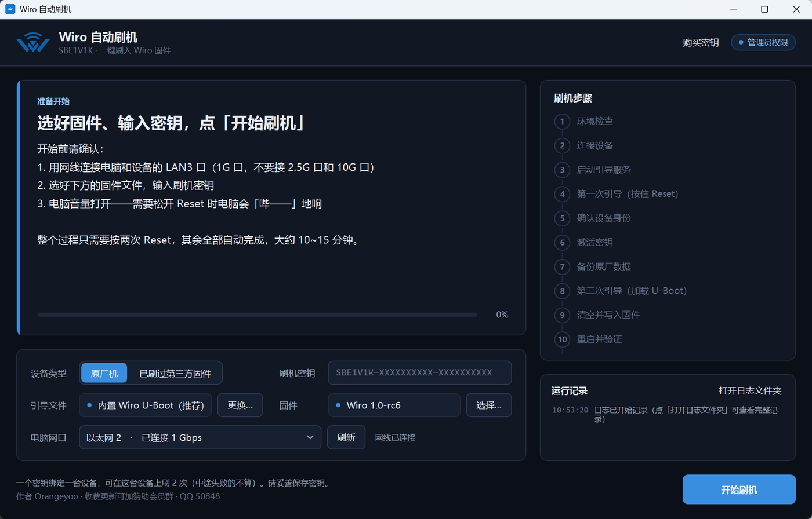
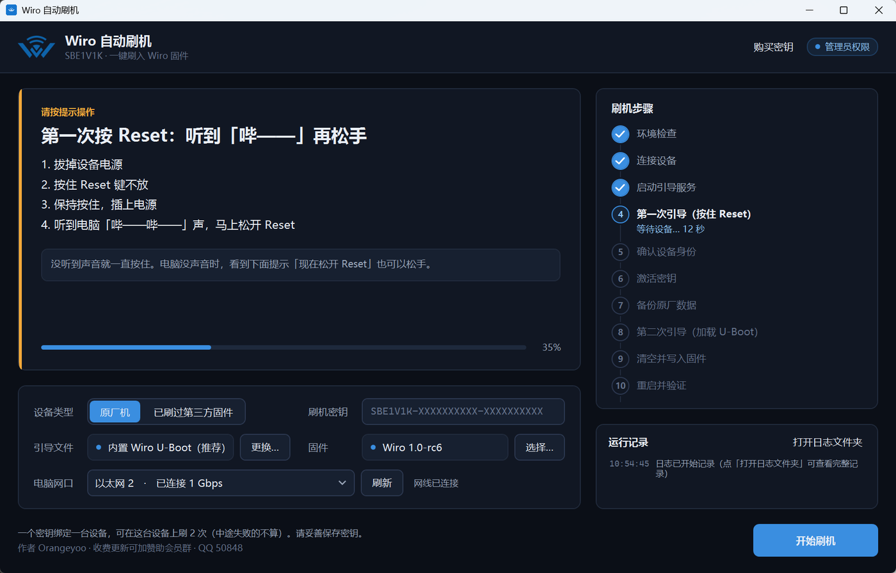
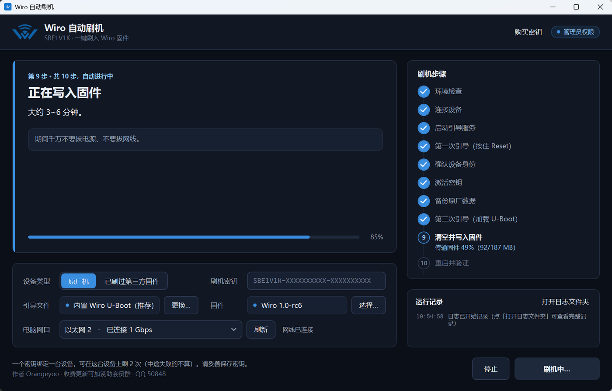
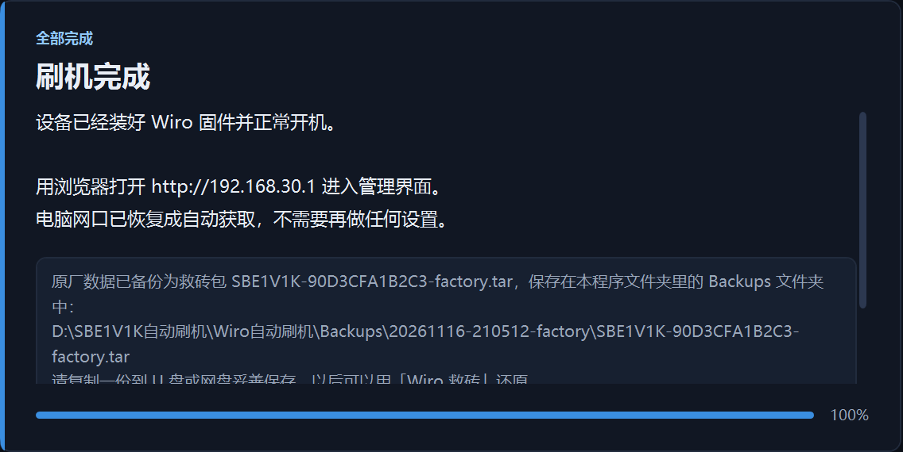

  

<h1 align="center">SBE1V1K 刷机 · 免拆机免 TTL 一键刷 OpenWrt / iStoreOS</h1>

  <b>Spectrum SBE1V1K（Askey RTQ7300T）Wi-Fi 7 路由器 · 高通 IPQ9574 + 3× QCN9224</b> 
  不拆壳、不接线、不敲命令，按两次 Reset，10 分钟刷好 Wiro iStoreOS 固件

  
  

  
  
  
  
  
  
  

  <a href="#一键刷机">一键刷机</a> ·
  <a href="#三步刷好">三步刷好</a> ·
  <a href="#固件亮点">固件亮点</a> ·
  <a href="#实测速度">实测速度</a> ·
  <a href="#常见问题">常见问题</a> ·
  <a href="../../releases/latest">下载</a> ·
  <a href="README-EN.md">English</a>

---

## 一键刷机

SBE1V1K 原厂系统锁得很死，常规刷 OpenWrt 要拆壳、焊/夹 TTL、配 TFTP、在 U-Boot 里一行行敲命令，一步出错就可能变砖。

**Wiro 自动刷机**把这些全部自动化了：

| | 传统 TTL 刷机 | **Wiro 一键刷机** |
|---|---|---|
| 拆机 | 要拆壳找串口 | **不用拆** |
| 工具 | USB-TTL 模块、杜邦线、TFTP 软件 | **一根网线** |
| 操作 | 改 IP、敲十几条命令 | **按两次 Reset**，听到「哔」声松手 |
| 时间 | 1～2 小时 | **10～15 分钟** |
| 原厂备份 | 手动下载，约 1.5 小时 | **自动备份**引导区和射频校准数据，生成救砖包 |
| 刷坏了 | 只能再拆机接 TTL | **Wiro 救砖**一键恢复 |
| 售后 | 自己琢磨 | **会员群**答疑 + 后续固件更新 |

| 按 Reset 时有声音提示 | 全自动写入固件 |
|---|---|
|  |  |

### 购买与会员

- **[点这里购买刷机密钥](https://wzyp.cn/shop/155QK568)**：一个密钥绑定一台设备，可以在这台设备上刷 **2 次**，中途失败的不计次数
- 购买后加入**会员群 1061612207**：刷机答疑、后续固件更新优先获取
- 为什么收费：帮你省下拆机、接线、调试的时间；收入用于继续优化这个固件——Wi-Fi 7 和 NSS 硬件加速的移植调试烧掉了大量 AI 算力费用

## 三步刷好

1. **下载**：到 [Releases](../../releases/latest) 下载 `Wiro-AutoFlash` 压缩包，完整解压（固件已经附带）
2. **连接**：网线接设备的 **LAN3 口（1G 口）**，右键程序「以管理员身份运行」，输入密钥，点「开始刷机」
3. **按提示按两次 Reset**：剩下的全自动，完成后浏览器打开 `192.168.30.1`

图文教程：[SBE1V1K 刷机与救砖教程（PDF）](docs/SBE1V1K-Flashing-Guide-ZH.pdf)

**救砖包自动保存**：刷原厂机时，原厂引导区和射频校准数据会备份到 `Wiro自动刷机\Backups\`。射频校准每台机器独一无二，请复制一份到 U 盘或网盘。

## 固件亮点

Wiro 固件把 SBE1V1K 从原厂 Linux 5.4 + 闭源驱动，完整移植到 **高通 QSDK 14（OpenWrt 24.10 / Linux 6.6 / 开源 ath12k）**：

| | |
|---|---|
| **Wi-Fi 7 三频** | 2.4 GHz EHT40 · 5 GHz EHT160 · 6 GHz **EHT320**；OWE 过渡，老设备也能连 |
| **两台 Mesh 组网** | 6 GHz 320 MHz 专用回程，实测 1.17 Gbps |
| **10G 万兆口** | 实测 **7.72 Gbps**，接交换机 / NAS / 电脑都正常 |
| **NSS 硬件加速** | ECM + PPE 硬件转发，Wi-Fi PPE-DS 直通 |
| **更稳的无线** | WBE.1.4 无线固件：单个芯片出错约 8 秒原地恢复，不重启、不影响其它频段 |
| **iStoreOS** | iStore 应用商店（离线源，开箱可装）、QuickStart 首页向导 |
| **常用插件** | OpenClash、PassWall（Xray / sing-box）、Docker、AdBlock、WireGuard、OpenVPN、文件共享 |
| **PPPoE 优化** | 开机自动清理残留会话，升级不丢拨号记录 |
| **硬件全适配** | 风扇按温度调速、CPU 动态调压调频、状态灯、各网口原厂 MAC |

## 实测速度

2026-11-17 实测，两台 SBE1V1K 组网日常使用中（主路由 + Mesh 节点），iperf3 3.22，电脑为 HPE 10G 网卡 + Qualcomm FastConnect 7800 Wi-Fi 7 网卡。

| 项目 | 结果 |
|---|---|
| 10G 口 电脑 → 路由 | **7.72 Gbps**（4 线程）· 4.70 Gbps（单线程） |
| 10G 口 路由 → 电脑 | **6.96 Gbps**（8 线程） |
| 6 GHz Mesh 回程 | 主 → 节点 **1.17 Gbps** · 节点 → 主 0.96 Gbps |
| 5 GHz 160 MHz | 上传 0.82 Gbps · 下载 0.61 Gbps（协商 2882 Mbps，节点同时承载 Mesh 和其它终端） |
| 连续运行 | 两台均 21 小时以上不重启，PPPoE 不掉线，无线零崩溃 |
| 温度 | 日常 54～59 °C，风扇约 2150 rpm |

## 常见问题

**问：SBE1V1K 能刷 OpenWrt 吗？需要拆机接 TTL 吗？**
答：能。用 Wiro 一键刷机不需要拆机，也不需要 TTL，一根网线即可。

**问：刷坏了怎么办？**
答：用配套的 Wiro 救砖可以重装 U-Boot、还原原厂引导区和射频校准数据。刷机中途失败，用同一个密钥重新刷，不计次数。

**问：还能刷回原厂吗？**
答：刷原厂机时会自动生成救砖包，原厂关键数据都在里面，可以用 Wiro 救砖写回。

**问：刷完怎么登录？**
答：浏览器打开 `http://192.168.30.1`，账号 `root`，初始密码 `password`。2.5G 口是 WAN 口，接光猫。

**问：以后怎么升级？**
答：在管理页面「系统 → 备份/升级」上传新的 `sysupgrade.bin` 即可，不用再按 Reset。会员群会第一时间发布新版。

**问：密钥能给别的设备用吗？**
答：不能。一个密钥绑定一台设备，可刷 2 次。多台设备需要分别购买。

## 下载

| 文件 | 用途 |
|---|---|
| `Wiro-AutoFlash-SBE1V1K-*.zip` | **一键刷机工具**（需要密钥；固件另行下载 `sbe1v1k-*-sysupgrade.bin`，在软件里选择） |
| `Wiro-Rescue-SBE1V1K-*.zip` | 救砖工具 |
| `SBE1V1K-Flashing-Guide-ZH.pdf` | 刷机与救砖图文教程 |
| `sbe1v1k-*-sysupgrade.bin` | 系统固件，已装 Wiro 固件的设备后台升级用 |
| `wiro-uboot-*.itb` | Wiro U-Boot（一键刷机已内置） |
| `SHA256SUMS.txt` | 校验值 |

→ **[前往 Releases 下载](../../releases/latest)** · **[购买刷机密钥](https://wzyp.cn/shop/155QK568)**

## 开源与致谢

固件和 Wiro U-Boot 按 GPL 开源：固件源码见分支 [`source-1.0`](../../tree/source-1.0)，U-Boot 源码见分支 [`uboot-1.9c`](../../tree/uboot-1.9c)；动手能力强的用户也可以参考 [手动刷机说明](FLASHING-GUIDE.md)。一键刷机、救砖工具为闭源收费软件。许可证详见 [ATTRIBUTION.md](ATTRIBUTION.md)。

固件和 U-Boot 由 **Orangeyoo** 移植和维护。感谢 [YYH2913](https://github.com/YYH2913)、所有上游开源项目（OpenWrt、Qualcomm QSDK、Linux / ath12k、U-Boot、iStoreOS 等）的作者，以及 AI 助手 GPT、Claude、GLM。

## 会员群

作者 **Orangeyoo** · QQ **50848** · 会员群 **1061612207**（[购买刷机密钥](https://wzyp.cn/shop/155QK568)后可加入）

本项目为非官方社区固件，与 Spectrum、Charter、Askey、Qualcomm 无关。刷机有风险，因刷机造成的损坏由使用者自行承担。

SBE1V1K 刷机 · SBE1V1K OpenWrt · SBE1V1K iStoreOS · Spectrum SBE1V1K firmware · Spectrum Wi-Fi 7 router OpenWrt · Askey RTQ7300T 刷机 · RTQ7300T OpenWrt · IPQ9574 OpenWrt · QCN9224 ath12k · Wi-Fi 7 路由器刷机 · 免拆机刷机 · 免 TTL 刷机 · 一键刷机 · 救砖
